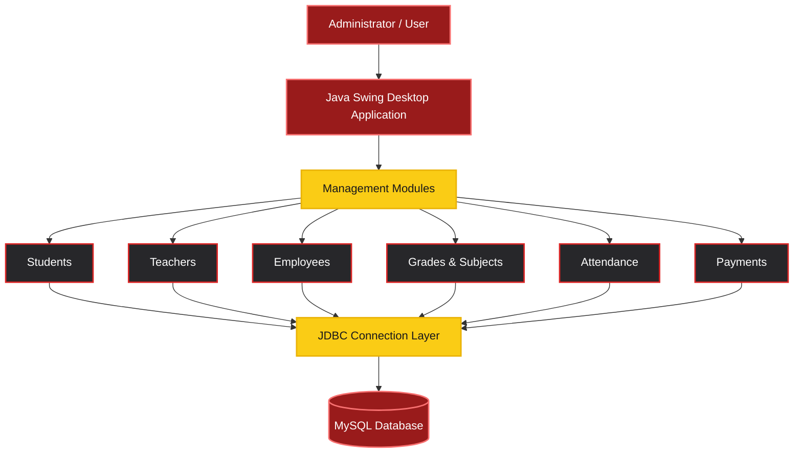
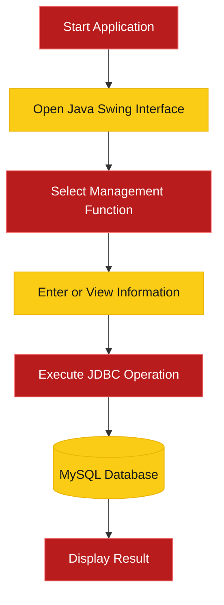

<div align="center">


<br/>


<br/><br/>


<br/>

### 🔥 ORGANIZE • MANAGE • TRACK

**A Java desktop application designed to simplify academic and administrative record management.**

[](https://github.com/AkashAmarasinghe/class-management-system)
[](https://github.com/AkashAmarasinghe)

</div>

---

## 🔴 PROJECT OVERVIEW

**Class Management System** is a Java Swing desktop application developed using **Apache NetBeans, MySQL and JDBC**.

It provides a graphical environment for organizing different types of academic and administrative information.

The project includes source code for managing:

- Student records
- Teachers and teacher addresses
- Employee information
- Grades and subjects
- Attendance records
- Payment information
- Administrator login

The system uses **Java Swing** for the user interface and **MySQL** for database storage.

---

## 🟡 KEY FEATURES

<table>
<tr>
<td align="center" width="50%">

### 🎓 STUDENT MANAGEMENT

Manage student-related information and database records.

</td>
<td align="center" width="50%">

### 👨‍🏫 TEACHER MANAGEMENT

Organize teacher details and address information.

</td>
</tr>
<tr>
<td align="center">

### 👥 EMPLOYEE MANAGEMENT

Maintain employee and staff records.

</td>
<td align="center">

### 📚 GRADES & SUBJECTS

Organize academic grades and subject information.

</td>
</tr>
<tr>
<td align="center">

### 📅 ATTENDANCE TRACKING

Handle attendance-related records and information.

</td>
<td align="center">

### 💳 PAYMENT MANAGEMENT

Manage payment-related information and database operations.

</td>
</tr>
<tr>
<td align="center" colspan="2">

### 🔐 ADMINISTRATOR LOGIN

Dedicated administrator login interface.

</td>
</tr>
</table>

> **Project note:** These modules were identified in the original source code. Full runtime functionality has not yet been verified.

---

## 🔴 TECH STACK

<div align="center">

| Technology | Description |
|:---:|:---|
| ☕ **Java 8** | Core application development |
| 🖥️ **Java Swing** | Desktop graphical user interface |
| 🧰 **Apache NetBeans** | IDE and GUI Builder |
| 🗄️ **MySQL** | Relational database |
| 🔗 **JDBC** | Database connectivity |
| 🎨 **FlatLaf** | Modern Swing UI components |
| 📆 **JCalendar** | Date selection components |
| 🐜 **Apache Ant** | Project build system |

<br/>


</div>

---

## 🟡 SYSTEM ARCHITECTURE

The application connects its Java Swing interface to a MySQL database through JDBC.



---

## 🔴 APPLICATION WORKFLOW



---

## 🟡 APPLICATION SCREENSHOTS

<div align="center">

**Application Interface Preview**

| Administrator Login | Main Window |
|:---:|:---:|
| Screenshot coming soon | Screenshot coming soon |

| Student Management | Teacher Management |
|:---:|:---:|
| Screenshot coming soon | Screenshot coming soon |

</div>

> Screenshots will be added after capturing the actual running application.

---

## 🔴 PROJECT STRUCTURE

```text
class-management-system/
│
├── src/
│   │
│   ├── gui/
│   │   ├── adminLogin.java
│   │   ├── adminLogin.form
│   │   ├── home.java
│   │   ├── home.form
│   │   ├── teacherAdress.java
│   │   └── teacherAdress.form
│   │
│   ├── model/
│   │   └── mySql.java
│   │
│   └── img/
│       └── Application Icons
│
├── lib/
│   └── External Dependencies
│
├── manifest.mf
├── .env.example
├── .gitignore
└── README.md
```

The project also requires its NetBeans Ant build configuration files, including `build.xml` and `nbproject/`, to be recognized and built normally as a NetBeans project. Verify that these files are present in your local copy.

---

## 🟡 INSTALLATION GUIDE

### Step 01 — Requirements

Install the following software:

- Apache NetBeans IDE
- Compatible Java Development Kit
- MySQL Server
- Git (optional)

The original NetBeans project targets Java 8 source compatibility.

### Step 02 — Clone Repository

Open Git Bash, PowerShell or another terminal.

```bash
git clone https://github.com/AkashAmarasinghe/class-management-system.git
```

Navigate into the project:

```bash
cd class-management-system
```

### Step 03 — Database Setup

Create the database in MySQL:

```sql
CREATE DATABASE learn;
```

**Important:** The original archive does not include a SQL database export or schema.

Required tables and relationships must be obtained or reconstructed before the application can run successfully.

### Step 04 — Configure Database Connection

The prepared project reads MySQL connection information from environment variables.

In Windows PowerShell:

```powershell
$env:CLASS_DB_URL = "jdbc:mysql://localhost:3306/learn"
$env:CLASS_DB_USER = "root"
$env:CLASS_DB_PASSWORD = "YOUR_LOCAL_PASSWORD"
```

Replace `YOUR_LOCAL_PASSWORD` with your own MySQL password.

Launch NetBeans from the same PowerShell session, or configure these values as Windows environment variables.

The `.env.example` file is a reference only. The application does not automatically load `.env` files.

### Step 05 — Open the Project

1. Open Apache NetBeans.
2. Select **File → Open Project**.
3. Locate the project directory.
4. Select the project.
5. Resolve missing dependencies under **Project Properties → Libraries**, if required.
6. Build and run the application.

The configured main class is:

```java
gui.home
```

---

## 🔴 SECURITY INFORMATION

This repository is intended for educational and development purposes.

The prepared version removes the original hardcoded MySQL credentials from the Java source code.

Further security improvements are recommended:

- Use prepared SQL statements.
- Implement secure password hashing.
- Validate all database inputs.
- Improve authentication and authorization.
- Keep credentials outside source code.
- Avoid committing sensitive database information.

---

## 🟡 FUTURE IMPROVEMENTS

Possible future enhancements include:

- Advanced search and filtering
- Report generation
- Export data to PDF and Excel
- Improved authentication security
- Role-based access control
- Enhanced form validation
- Automated testing
- UI and UX improvements

These are planned ideas rather than confirmed implemented features.

---

## 🔴 PROJECT STATUS


This project was developed for educational purposes.

The source code and project documentation were reviewed, but complete database functionality and runtime behavior have not yet been verified.

---

## 🟡 DEVELOPER

<div align="center">


<br/>

### 👨‍💻 AKASH AMARASINGHE

**Software Engineering Undergraduate**

**Full-Stack Developer | Java Enthusiast**

<br/>

[](https://github.com/AkashAmarasinghe)

[](https://github.com/AkashAmarasinghe/class-management-system)

<br/>

**Built with Java ☕ | Designed with Passion ❤️**


</div>
